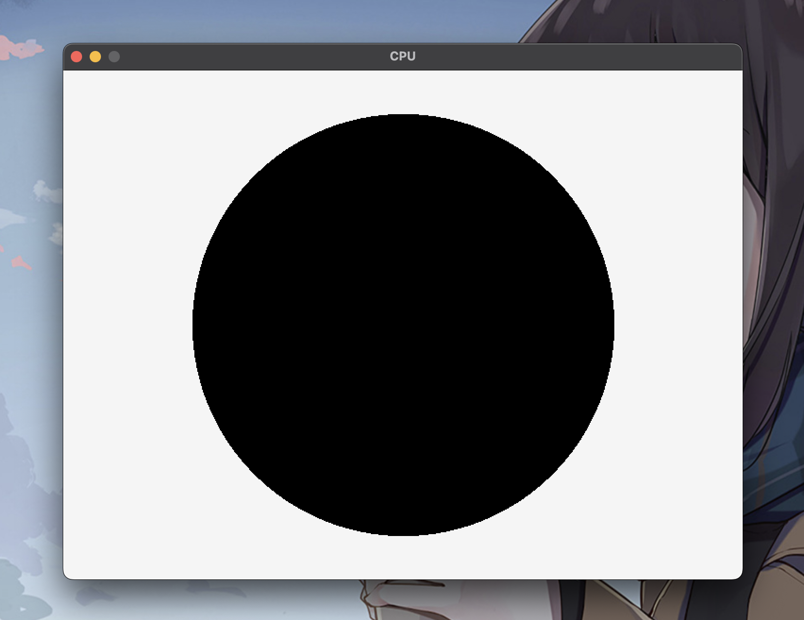

# The processor
В данном репозитории содержится виртуальная машина, работающая на своем ассемблере. Для работы активно используется [стэк](https://github.com/Tamik13/secure_stack), реализованный тоже мной). Также на процессоре предусмотрен функционал для вывода черно-белых изображений в графическое окно. Для графики используется библиотека [reilib](https://www.raylib.com/)

* [Основной функционал](#Основной-функционал)
* [Структура](#Структура)
    * [Команды ассемблера](#команды-ассемблера)
* [Структура](#структура)
* [Оптимизации](#оптимизации)
    * [Ассемблер](#ассемблер)
    * [Процессор](#процессор)
* [Благодарности](#благодарности)

# Основной функционал

В папке examples представлены примеры реализованных на ассемблере программ:
* факториал
* таблица квадратов до 10
* решение квадратных уравнений
* вывод круга в графическом окне

* сгенерированный код для воспроизведения bad apple

Для генерации кода bad apple написана программа на c которая кодирует каждый пиксель в черно белом формате ассемблера. Для оптимизации используется дельта кодирование (Если цвет пикселя не изменился, то мы его не кодируем).

## Команды ассемблера

Для хранения данных предусмотренно три варианта:
* Стек
* Регистры (rax, rbx, rcx и rdx)
* Оперативка (обращение к ячейке оперативки в функциях: [номер ячейки])

Всего предусмотренно 22 команды:

|Команда|Описание|Аргументы|
|-|-|-|
|pop|Удаляет один элемент из конца стека и кладет в оперативную память/ регистр|RAM/REG|
|push|Добавляет один элемент в стек/оперативку/регистр|RAM/REG/CONST|
|add|Складывает два последних элемента из стека, удаляя их и добавляет результат сложения|-|
|mul|Умножает два последних элемента из стека удаляя их и добавляет результат деления|-|
|div|Делит два последних элемента из стека удаляя их и добавляет результат деления|-|
|out|Выводит последний элемент из стека|-|
|in|Считывает число из терминала в стек|-|
|sin/cos/sqr|Вычисляют синус/косинус/корень последнего элемента из стека записывая результат вместо числа|-|
|jmp|Меняет текущую команду на следующую после указанной метки|Метка|
|ja/je/jbe/jae|Совершают jmp если сравнивая и удаляя последние два элемента|Метка|
|call|Вызывает функцию|Метка функции|
|ret|Завершает функцию|-|
|dmp|Обновляет графическое окно значениями оперативной памяти|-|
|wait|Ждет нажатия пробела|-|
|hlc|Завершает работу процессора|-|

# Структура
Проект состоит из двух основных частей:
* Ассемблер
Читает текстовый файл, указанный в аргументе командной строки и преобразует его в бинарник, который читает процессор.
* Процессор
Загружает программу в память и последовательно выполняет команды.

# Оптимизации
## Ассемблер
* Сравнение строк с помощью хешей
* Поиск хеша команды с помощью бинарного поиска (это также помогло удалить copy-past)
## Процессор
* Бинарник в бинарном формате)
* Поиск команды путем индексации в массиве (тоже убрало copy-past)
* Команды хранятся в битовых полях

# Благодарности
Автор выражает глубокую признательность студенту МОСКОВСКОГО ФИЗИКО ТЕХНИЧЕСКОГО ИНСТИТУТА [Степе](https://github.com/SSStepa/Processor) за пример оформления репозитория
